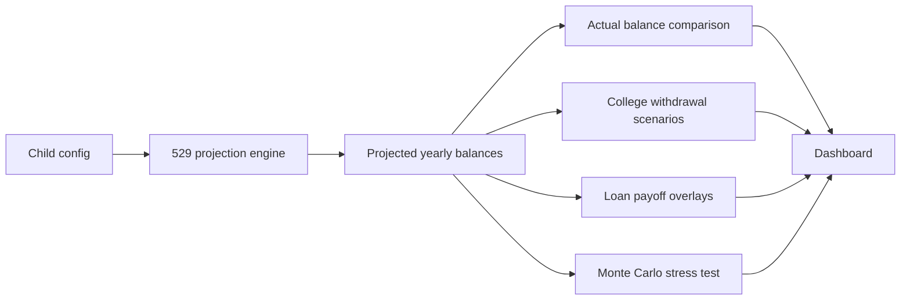

# 🎓 Education Calculator


Plan, track, and stress-test 529 education savings for multiple children in one clean dashboard.

This app combines projected balances, real yearly account snapshots, college withdrawal scenarios, and household loan overlays so you can quickly answer one question: **Are we on track?**

> This is a local-only copy. It ships with **fictional sample data** in `data/children.json` (child names are placeholders). Edit that file to model your own children.

---

## Why this project exists

Most calculators stop at a single projection. This one is built to compare:

- **projected vs actual** 529 balances
- **direct 4-year vs 2+2** college paths
- **education savings vs student-loan payoff** scenarios
- **base projection vs Monte Carlo stress test** outcomes

---

## What it does

| Feature | What you get |
| --- | --- |
| 529 growth modeling | Age-based projection from birth through college years |
| Actual balance tracking | Add, edit, and delete yearly account snapshots |
| Withdrawal planning | Compare 4-year university and community-college-to-university paths |
| Loan overlays | Plot household student-loan payoff scenarios beside savings curves |
| Stress testing | Run Monte Carlo simulations for 4-year college-fund success probability |
| Secure access | Basic auth, local-dev bypass, and hardened security headers |

---

## Snapshot



---

## Tech stack

- **Backend:** FastAPI
- **Database:** SQLite (default for local use); PostgreSQL is supported through `DATABASE_URL`
- **ORM:** SQLAlchemy
- **Templates:** Jinja2
- **Charts:** Chart.js
- **Tests:** Pytest

Key entry points:

- [app/main.py](app/main.py)
- [start_web.ps1](start_web.ps1)

---

## Quick start

Install [uv](https://docs.astral.sh/uv/getting-started/installation/) once before using these commands. On Windows, you can install it with:

```powershell
winget install --id astral-sh.uv -e
```

### Option 1: easiest path

```powershell
cd education-calculator-local
.\start_web.ps1
```

### Option 2: manual setup

```powershell
cd education-calculator-local
uv sync
uv run uvicorn app.main:app --reload --host 127.0.0.1 --port 8001
```

Open:

- `http://localhost:8001/`
- `http://localhost:8001/health`

---

## Environment variables

### Auth

Set these if you want authenticated access. A blank password disables that account.

- `AUTH_STEVEN_PASSWORD`
- `AUTH_ALYSSA_PASSWORD`
- `AUTH_GUEST_PASSWORD`

### Database

- `DATABASE_URL` — optional locally

If `DATABASE_URL` is not set, the app uses local SQLite by default.

---

## API surface

### Page + health

- `GET /`
- `GET /health`

### Projection endpoints

- `GET /api/comparison/{child_name}`
- `GET /api/comparison-all`

### Actual balance endpoints

- `POST /api/balances/{child_name}`
- `GET /api/balances/{child_name}`
- `PUT /api/balances/{balance_id}`
- `DELETE /api/balances/{balance_id}`

### Stress test endpoints

- `GET /api/stress-test/{child_name}`
- `POST /api/stress-test/{child_name}/recalculate`

---

## Project layout

```text
education-calculator-local/
├─ app/
│  ├─ main.py              # FastAPI app setup
│  ├─ auth.py              # Basic auth and roles
│  ├─ database.py          # engine, sessions, initialization
│  ├─ models.py            # SQLAlchemy models
│  ├─ routes/              # page and API routes
│  ├─ services/            # projections, withdrawals, loans, Monte Carlo
│  ├─ static/              # CSS and JavaScript
│  └─ templates/           # Jinja templates
├─ data/children.json      # sample child configurations
├─ lib/calculator.py       # pure projection math
├─ tests/                  # pytest coverage
├─ requirements.txt
└─ start_web.ps1
```

---

## Core assumptions

- Child allocations shift across **3 age bands**: growth, moderate, conservative.
- Contributions compound over time and can grow annually.
- Withdrawal scenarios use **North Carolina public-school cost anchors**.
- Monte Carlo testing currently targets the **direct 4-year university** path.
- The dashboard supports up to **3 seeded children** out of the box.

See [data/children.json](data/children.json) to adjust assumptions.

---

## Testing

```powershell
cd education-calculator-local
uv run pytest -q
```

---

## Best for

- families tracking real 529 progress over time
- comparing education funding paths without opening spreadsheets
- pairing college savings planning with loan payoff visibility
- getting a quick probability-based read on plan durability

## Not trying to be

- a full tax-planning engine
- a financial-advice product
- a scholarship/aid optimizer
- a universal tuition model for every school and geography

---

## In one line

**A focused FastAPI dashboard for 529 planning, actual balance tracking, college-cost scenarios, and education funding stress tests.**
